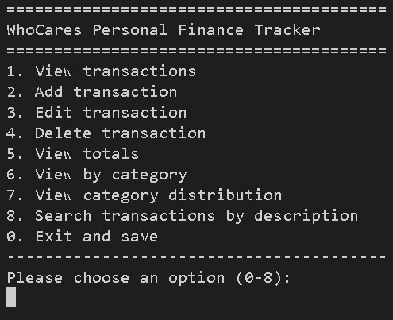
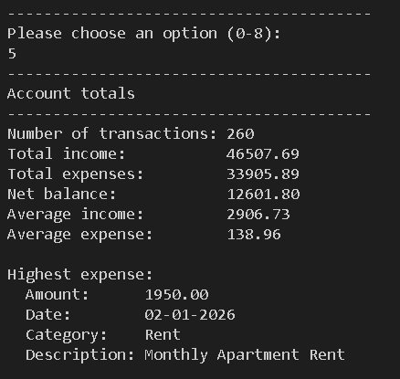

# WhoCares Personal Finance Tracker 💰

  

A command-line personal finance tracker built in Haskell that helps you manage your income and expenses with ease. Record transactions, keep track of your balance, and understand where your money goes, all from your terminal.

[](https://youtu.be/TZ4GRFaMjcU)

## What It Does

- **Track your transactions** - Add, edit, delete, and view income and expenses with dates, categories, and descriptions.
- **Understand your finances** - View running balances, totals, averages, and your highest expense.
- **Explore spending patterns** - Filter by category and see how income and expenses are distributed across 12 categories.
- **Find transactions quickly** - Search descriptions using case-insensitive keywords.

## Screenshots

<p align="center">
  
  
</p>

## Features

- ✅ **Interactive menu** - Navigate all operations through a simple numbered menu.
- ✅ **Smart date input** - Press Enter to use today's date or enter a custom date.
- ✅ **Input validation** - Handle invalid dates, amounts, categories, and IDs gracefully.
- ✅ **Quick editing** - Keep existing field values by pressing Enter.
- ✅ **Persistent storage** - Load transactions from CSV and save changes on exit.
- ✅ **Sample data** - Get started with a built-in sample ledger if no valid CSV is available.

**Supported categories:** Food · Rent · Transport · Salary · Entertainment · Utilities · Healthcare · Education · Shopping · Investment · Travel · Other

## Under the Hood

- **Algebraic data types and typeclasses** for type-safe transactions and reusable ID operations.
- **Custom validation monad** with `Functor`, `Applicative`, and `Monad` instances for chaining validation steps.
- **Pure functions and folds** for financial analytics and running balances.
- **Cassava** for CSV encoding and decoding, with exception handling for file access.
- Separation of pure business logic from interactive I/O.

## Getting Started

Install [Stack](https://docs.haskellstack.org/), then run:

```bash
git clone https://github.com/WhoCares258/finance-tracker.git
cd finance-tracker
stack build
stack run
```

Transactions are loaded from `ledger.csv` on startup and saved when you select **Exit and save**.

## Main Menu Options

```text
1. View transactions
2. Add transaction
3. Edit transaction
4. Delete transaction
5. View totals
6. View by category
7. View category distribution
8. Search transactions by description
0. Exit and save
```

## License

BSD-3-Clause
